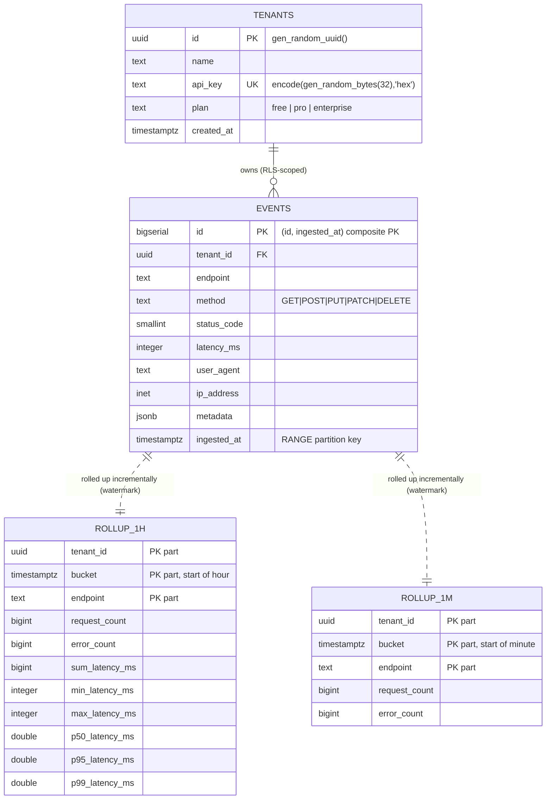

# ERD — PgPulse



## Partitioning layout

`events` is the partitioned parent; physical rows live in daily children
(`events_YYYYMMDD`), plus the monthly ones created by migration 002 until they
age out:

```
events (PARTITION BY RANGE (ingested_at))
├── events_2026_11   FROM ('2026-11-01') TO ('2026-12-01')   <- monthly, from 002
├── events_20261201  FROM ('2026-12-01') TO ('2026-12-02')   <- daily, from 010
├── events_20261202  FROM ('2026-12-02') TO ('2026-12-03')
└── ... through today + 7 days

expired daily partitions: DETACH CONCURRENTLY -> Parquet on S3/MinIO -> DROP
```

Indexes, RLS policies, and the FK are declared on the parent and inherited by
every current and future child partition.
